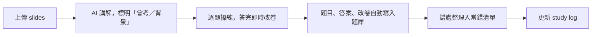

這個學期修 DSAI4204 Data Mining and Data Warehousing，十月底有一個一小時的 in-class test，範圍是 Association Rule Mining（ARM）和 Classification I，可以帶一張 A4 cheat sheet。

這篇記錄我怎樣用 AI 溫這一科：不是叫它幫我做筆記，而是讓它當考官，一題一題考我、即時改卷，再把錯處整理成一張「常錯清單」。如果你也想用 AI 溫書，可以直接照這個流程做。

<!-- more -->

## 每一章的流程

1. **先講 slides，並標明哪些會考。** 我要求 AI 講解時分清楚「考試會考」和「背景知識」：會考的講深一點，背景的帶過就算。時間有限，這一步省了很多力。
2. **逐題做，答完即時改。** 不是一次過出十題，而是一題做完就改，錯了馬上知道錯在哪裡。
3. **自動寫入題庫。** 每一題的題目、我的答案和改卷，都會自動寫入一份「ARM 練習題庫」文件，不用我每次提醒。
4. **常錯清單。** 重複出現的錯另外列成清單，放在題庫裡。
5. **Study log。** 每科一份進度記錄，下次開新對話可以直接接上，不用重講溫到哪裡。

## 練了什麼

ARM I 和 ARM II 一共練了 16 題：

| 章節 | 練習範圍 |
| --- | --- |
| ARM I | support、confidence、Apriori、candidate generation、rule generation、lift、效能瓶頸 |
| ARM II（sequential ARM） | 首三步：customer sequence、按客戶計的 frequent itemset、transformation |

<!-- TODO(Joe)：補 Classification I 有沒有溫、past paper 做了哪幾份 -->

## 我的常錯清單

這張清單是整個過程最有價值的產物。寫下來之後才發現，很多錯不是不懂，而是步驟漏了：

| 類型 | 錯在哪裡 | 正確做法 |
| --- | --- | --- |
| 分母 | support 分母用錯 | ARM I 用總交易數；ARM II 用總客戶數 |
| 分母 | confidence 分母用錯 | 用前提 X 的出現次數 |
| 數字 | 小數截斷，2/3 寫成 66% | 照實四捨五入 |
| 規則 | 生成規則時混用不同 itemset 的 item | 只從同一個 frequent itemset 拆 |
| Candidate | 直接抄交易，或由 L1 join | 由 L(k-1) join 出來 |
| Candidate | 漏了 join 組合；join 和 prune 步驟沒寫出來 | 每一步都寫出來 |
| 過程 | 數錯次數 | 逐行點算 |
| 答案 | 漏了某一層，或沒有結論句 | 最後寫一句總結 |
| 簡答 | 只講做了什麼，沒講原理或效果 | 補「為什麼」和「帶來什麼」 |
| Transformation | 以為要完全符合才保留 | 只要包含至少一個 frequent itemset 就保留，例如 (A,D) 因為包含 (A) 而保留，而且要列出所有包含的 frequent itemset |
| Transformation | 最大 itemset 的大小數了 ID | 數的是 item 數目 |

## 時間不夠的時候

到考試前兩日，我還沒讀 Classification I，就把節奏改成直接做 past paper。

<!-- TODO(Joe)：補最後兩日怎樣分配時間、past paper 做得怎樣（不用寫分數） -->

<!-- TODO(Joe)：補 cheat sheet 怎樣做——常錯清單有沒有直接放進去 -->

## 考完回看

<!-- TODO(Joe)：補考試當日的感受：常錯清單有沒有幫到、哪一類題目最意外（不寫分數） -->

如果你想照做，最重要的一點是：**讓 AI 改卷，不要讓它做筆記。** 做筆記你會以為自己懂了，被改卷才知道哪裡其實不懂。

<!-- TODO(Joe)：確認最後這句結論是否符合你的想法，不符合就改 -->
