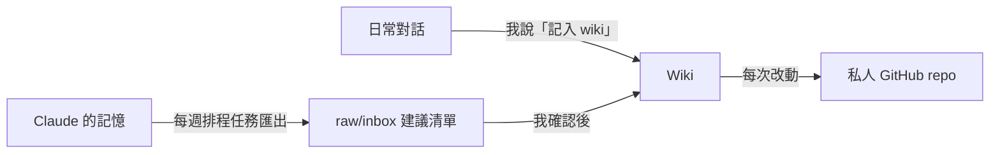

我一直想有一個地方，記下自己的想法、讀過看過的東西、課程知識和生活上各個範疇的事。問題是我從來沒寫過反思，也不太可能每天自己坐下來整理筆記。

後來我試了 Karpathy 提出的 LLM Wiki 方法：資料由我提供，整理和維護交給 AI。這篇記錄我的 vault「Joe's Mindset」是怎樣搭起來的、資料怎樣流進去，以及我給 AI 定的幾條邊界。

<!-- more -->

## LLM Wiki 是什麼

Karpathy 提出的 LLM Wiki，簡單來說，就是讓 LLM 幫你維護一個持續累積的個人知識庫。你提供原始資料，AI 負責整理成 Markdown 頁面、連結相關概念，並在有新資料時更新現有內容，而不是每次都重新開始。

我想試這個方法，主要是希望 AI 能累積我的個人背景。以往即使跟 AI 討論過很多事情，換一個對話也未必能完整接上之前的脈絡。有了 wiki，我就可以把過往的想法、經歷和知識整理在同一個地方，讓 AI 之後回答問題時有更多背景可以參考。

原始構想可參考：[Andrej Karpathy 的 LLM Wiki](https://gist.github.com/karpathy/442a6bf555914893e9891c11519de94f)。
我的做法是把它放進 Obsidian：wiki 頁面全部用繁體中文寫，專有名詞保留英文。

## 收什麼、不收什麼

| 收進 wiki | 不收進 wiki |
| --- | --- |
| 反思／日記 | 課程內容（例如 Data Mining 的 Association Rule Mining） |
| 讀過、看過的東西 | |
| 課程知識 | |
| 工作和生活上的各個範疇 | |

課程方面，我只會把自己的理解、疑問，以及課堂知識與個人經歷的連結放進 wiki；定義、公式和例子等課堂內容則留在各科的 study log，避免同一份知識出現兩個版本。

課程內容我已經有每科一份 study log，所以不另外開 wiki 概念頁，免得同一份知識有兩個版本。

我把原始資料和整理好的 wiki 分開存放。`wiki/` 存放整理後的知識頁面；`raw/claude-memory/` 用來保存每週匯出的 Claude 記憶；`raw/inbox/` 則存放等待我確認的更新建議。

這樣分開的目的，是避免原始資料或 AI 提出的建議直接變成正式記錄，讓我可以先檢查，再決定是否更新 wiki。

## 不會寫反思，就讓 AI 訪問我

這是整個設計裡我最喜歡的一部分。與其逼自己對著空白頁寫，不如讓 AI 問問題、我回答，再由它把答案整理進 wiki。說「繼續訪談」就可以接著上次的進度問下去。

例如，AI 曾經問我：

- 你覺得自己最強的一樣東西是甚麼？朋友通常會找你幫甚麼忙？
- 講一次你覺得自己做得不好或者失敗的經歷。你當時怎樣反應？事後又怎樣看？
- 你投資美股，又定了很嚴格的每週開支上限。對你來說，錢最主要是用來做甚麼？
- 你擔心 AI 取代單一技能，但自己又很依賴 AI 做事。你怎樣分辨哪些工作交給 AI，哪些一定要自己懂？

我喜歡這種方式，因為我不用對著空白頁思考應該寫甚麼。AI 可以根據過往累積的資料提出問題，甚至把不同事情放在一起，讓我重新思考自己的想法。回答之後，它也會負責整理內容、建立或更新頁面，以及連結相關資料。

對我來說，重點不是讓 AI 代替我思考，而是由 AI 負責提問和整理，讓我更容易把原本沒有記錄下來的想法留下來。

## 一次只吃一份資料，改之前先討論

新資料是**一份一份**加進去的，而且每一份都要先跟 AI 討論過，wiki 才會更新。這樣慢一點，但我知道每一頁為什麼會變成現在這樣。

我把維護規則寫成一份 skill，常用的指令有幾個：

| 指令 | 做什麼 |
| --- | --- |
| 記入 wiki／ingest 呢段對話 | 把這次對話整理進 wiki |
| ingest inbox | 處理收件箱裡待確認的建議 |
| lint／健康檢查 | 檢查 wiki 本身有沒有問題 |
| 繼續訪談 | 接著上次的反思訪問 |
| 同步 GitHub | 把改動備份上去 |

我也設了 lint／健康檢查，定期檢查 wiki 的基本結構有沒有問題，包括連結是否指向不存在的頁面、`index.md` 有沒有遺漏頁面、area 頁面是否超過 60 日未更新，以及 vault 根目錄有沒有不應存在的雜檔。

這些檢查主要針對 wiki 的結構和維護情況，讓我可以及早發現需要處理的地方。

## 兩條更新路線

1. **即時**：在任何對話裡說「記入 wiki」，那段對話就會被整理進去。
2. **每週**：一個排程任務把新增的 Claude 記憶匯出，寫成一份「建議更新清單」放進 `raw/inbox`。它**不會直接改 wiki**，要等我確認。

## 我給 AI 定的邊界

- **其他 AI 只能參考，不能動手**：我也想利用其他 AI agent 的記憶來幫忙建 wiki，但它們只可以讀，不可以改 Claude 維護的 wiki 檔案。一個資料庫只有一個維護者，才不會互相覆蓋。
- **排程任務只提建議**：自動化的部分只寫進收件箱，決定權在我。
- **每次改動都備份**：vault 備份到一個私人 GitHub repo，wiki 一有改動就同步。

系統正式運作至今大約七天，但當中整理的資料其實由七月開始累積。目前 vault 約有 50 個 Markdown 檔案。

雖然使用時間仍然很短，但我已經把原本分散在不同對話中的資料，逐步整理成可以持續維護的知識庫。

## 小結

我建立 Joe's Mindset，最主要的目的，是希望 AI 可以更了解我，減少每次開新對話時重複交代背景的需要。

我不太可能每天坐下來寫反思，也不想把大量時間花在整理筆記上。所以，我選擇把資料提供給 AI，讓它負責整理、連結和維護，而我保留對內容的決定權。

目前系統只用了約七天，還不能判斷這套方法長遠會有多大幫助。不過，至少我已經找到一種比較適合自己的方式，逐步累積過往的想法、經歷和知識。

對我來說，Joe's Mindset 不只是用來保存資料，更是希望讓未來的 AI 不必每次都從零開始認識我。