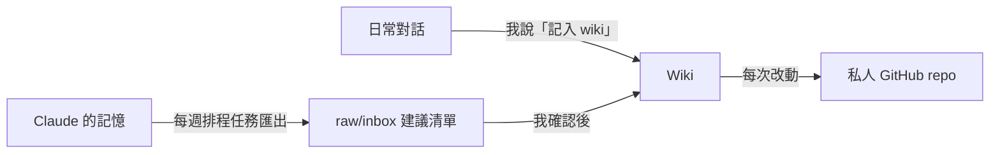

我一直想有一個地方，記下自己的想法、讀過看過的東西、課程知識和生活上各個範疇的事。問題是我從來沒寫過反思，也不太可能每天自己坐下來整理筆記。

後來我試了 Karpathy 提出的 LLM Wiki 方法：資料由我提供，整理和維護交給 AI。這篇記錄我的 vault「Joe's Mindset」是怎樣搭起來的、資料怎樣流進去，以及我給 AI 定的幾條邊界。

<!-- more -->

## LLM Wiki 是什麼

<!-- TODO(Joe)：用你自己的話簡單介紹 Karpathy 的 LLM Wiki 方法（原文出處連結、核心做法），我沒有足夠素材代寫 -->

我的做法是把它放進 Obsidian：wiki 頁面全部用繁體中文寫，專有名詞保留英文。

## 收什麼、不收什麼

| 收進 wiki | 不收進 wiki |
| --- | --- |
| 反思／日記 | 課程內容（例如 Data Mining 的 Association Rule Mining） |
| 讀過、看過的東西 | |
| 課程知識 | |
| 工作和生活上的各個範疇 | |

<!-- TODO(Joe)：「課程知識」收入 wiki 同「課程內容留喺 study log」點分界？補一句 -->

課程內容我已經有每科一份 study log，所以不另外開 wiki 概念頁，免得同一份知識有兩個版本。

<!-- TODO(Joe)：補 vault 的資料夾結構（例如 raw／wiki 等），最好附一張 Obsidian 截圖，記得遮走私人內容 -->

## 不會寫反思，就讓 AI 訪問我

這是整個設計裡我最喜歡的一部分。與其逼自己對著空白頁寫，不如讓 AI 問問題、我回答，再由它把答案整理進 wiki。說「繼續訪談」就可以接著上次的進度問下去。

<!-- TODO(Joe)：補一個訪談問題的例子（不用放答案），以及你覺得這種方式比自己寫好在哪裡 -->

## 一次只吃一份資料，改之前先討論

新資料是**一份一份**加進去的，而且每一份都要先跟 AI 討論過，wiki 才會更新。這樣慢一點，但我知道每一頁為什麼會變成現在這樣。

我把維護規則寫成一份 skill，常用的指令有幾個：

| 指令 | 做什麼 |
| --- | --- |
| 記入 wiki／ingest 呢段對話 | 把這次對話整理進 wiki |
| ingest inbox | 處理收件箱裡待確認的建議 |
| lint／健康檢查 | 檢查 wiki 本身有沒有問題 |
| 繼續訪談 | 接著上次的反思訪問 |
| 同步 GitHub | 把改動備份上去 |

<!-- TODO(Joe)：確認 lint／健康檢查實際會檢查什麼（斷鏈？重複頁？），補一兩句 -->

## 兩條更新路線

1. **即時**：在任何對話裡說「記入 wiki」，那段對話就會被整理進去。
2. **每週**：一個排程任務把新增的 Claude 記憶匯出，寫成一份「建議更新清單」放進 `raw/inbox`。它**不會直接改 wiki**，要等我確認。

## 我給 AI 定的邊界

- **其他 AI 只能參考，不能動手**：我也想利用其他 AI agent 的記憶來幫忙建 wiki，但它們只可以讀，不可以改 Claude 維護的 wiki 檔案。一個資料庫只有一個維護者，才不會互相覆蓋。
- **排程任務只提建議**：自動化的部分只寫進收件箱，決定權在我。
- **每次改動都備份**：vault 備份到一個私人 GitHub repo，wiki 一有改動就同步。

<!-- TODO(Joe)：補用了多久、現在大概有多少頁、有沒有哪次因為「改之前先討論」而避免了錯誤 -->

## 小結

<!-- TODO(Joe)：補一段你自己的感受——這個 wiki 對你最大的用處是什麼 -->
